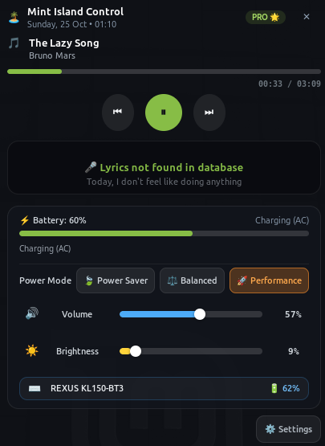

# 🏝️ Mint-Island (Native Dynamic Island for Linux Mint)

[](https://github.com/muhammadyusuftechid-star/mint-island/releases)
[](https://www.python.org/)
[](https://gnome.pages.gitlab.gnome.org/libadwaita/)
[](https://linuxmint.com/)
[](LICENSE)

> **Native, ultra-lightweight, and buttery-smooth Dynamic Island HUD & Control Center built specifically for Linux Mint 22.3 (Cinnamon DE on X11).**

Designed especially for users seeking an efficient, battery-friendly, and responsive desktop experience. Completely free of heavyweight web runtimes like Electron or Chromium — built purely with **Python 3.12, GTK4, Libadwaita, and Linux D-Bus**.

---

<p align="center">
  
</p>

<p align="center">
  <em>Expanded Control Center HUD — Live MPRIS Media Player, Synced Lyrics, UPower Battery Health, Power Profile Switcher &amp; Bluetooth Device Battery</em>
</p>

---

## ✨ Features Overview

| Feature | Description |
| :--- | :--- |
| **🏝️ Compact Micro-Pill (~120px)** | Slim, unobtrusive floating notch at the top center of your screen. Doesn't block browser tabs or window titlebars. |
| **✨ Smart Hover & Song Change Peek** | Expands smoothly to **360px** on mouse hover or track change, then gently collapses back to micro-pill with a debounced grace period. |
| **🎵 YouTube & Media Player Controller** | Instant MPRIS v2 media detection for YouTube (Brave/Chrome/Firefox), Spotify, VLC, and MPV. |
| **🎤 Real-Time Synced Karaoke Lyrics** | Live word-by-word synced lyrics powered by LRCLIB API with automatic offline disk caching (`~/.cache/mint-island/lyrics/`). |
| **🎧 Bluetooth & TWS Headphone HUD** | Real-time BlueZ connection events and battery level reporting for TWS earbuds, headphones, wireless keyboards, and mice. |
| **⚡ Power Profile Switcher & Battery Health** | One-click switcher between **Power Saver 🍃**, **Balanced ⚖️**, and **Performance 🚀**, plus remaining battery time estimates. |
| **🔊 Volume & Brightness HUD** | 3-second floating HUD popup with native color-coded progress indicators when hardware keys are pressed. |
| **🔔 Desktop Notification Interceptor** | Captures incoming notifications (chat, downloads, email, terminal) and displays them in the island. |
| **⚙️ Libadwaita Control Panel GUI** | Modern preferences window to toggle modules, customize positions, and adjust animations in real-time. |
| **📌 System Tray StatusNotifierItem** | Cinnamon panel tray icon for quick control and status. |
| **🔄 Seamless Autostart** | Automatically launches in the background on laptop reboot without opening a terminal window. |

---

## ⚡ Resource Efficiency (Lightweight & Battery Friendly)

Tested and benchmarked directly on Linux Mint 22.3 Zena:

| Metric | Real System Measurement |
| :--- | :--- |
| **Memory (RAM Usage)** | **< 45 MB** *(Ultra Lightweight)* |
| **CPU Usage (Idle)** | **0.0% – 0.1%** *(Zero Wakeups)* |
| **CPU Usage (Animating)** | **~1.5%** *(Native GTK CSS Transitions)* |
| **Application Footprint** | **< 3 MB** |

---

## 🚀 Installation Options

### Method 1: Graphical Installer (`.deb` Package) — ⭐ Recommended
The easiest way to install on Linux Mint or Ubuntu without touching code:

1. Download the latest installer package:  
   👉 **[Download mint-island_1.0.0_all.deb](https://github.com/muhammadyusuftechid-star/mint-island/releases/download/v1.0.0/mint-island_1.0.0_all.deb)** *(~108 KB)*
2. **Double-click** the downloaded `.deb` file in your file manager (Nemo) and click **"Install Package"** in GDebi.  
   *(Or via terminal: `sudo apt install ./mint-island_1.0.0_all.deb`)*
3. Done! Mint-Island will instantly appear in your **Application Menu**, register autostart on reboot, and can be uninstalled anytime from the Linux Mint Software Manager with one click.

---

### Method 2: One-Line Git Installer (For Developers)

```bash
git clone https://github.com/muhammadyusuftechid-star/mint-island.git
cd mint-island
./install.sh
```

The installer will automatically:
1. Register `mint-island` into your user autostart (`~/.config/autostart/`).
2. Add a desktop shortcut with settings action into the **Linux Mint Application Menu**.
3. Create the `mint-island` CLI binary in `~/.local/bin/`.
4. Launch the island overlay immediately on your screen.

---

## 🛠️ CLI Commands & Usage

```bash
# Open Settings & Preferences Window
mint-island --settings

# Check Daemon and Autostart Status
mint-island --status

# Run in background daemon mode
mint-island --daemon

# Run automated diagnostic test suite
python3 -m unittest discover tests

# Completely uninstall from system
./uninstall.sh
```

---

## 📁 Architecture & Clean Code Structure

```text
mint-island/
├── assets/                     # Visual assets & showcase preview
│   ├── mint-island.svg         # Official vector application icon
│   └── preview_control_center.png # Expanded Control Center HUD
├── pyproject.toml              # Modern PEP 621 Python packaging specification
├── install.sh                  # One-line automated installer
├── uninstall.sh                # Complete uninstaller
├── tests/                      # Automated unit test suite
│   ├── test_config.py          # Config manager tests
│   ├── test_lyrics.py          # Lyrics engine & YouTube cleaner tests
│   ├── test_license.py         # License engine tests
│   └── test_i18n.py            # Bilingual translation tests
├── mint_island/
│   ├── __init__.py             # Package version (v1.0.0)
│   ├── main.py                 # Application entry point & CLI handler
│   ├── config.py               # XDG JSON configuration manager
│   ├── autostart.py            # XDG Autostart (.desktop) manager
│   ├── i18n.py                 # Bilingual translation dictionary (ID & EN)
│   ├── license.py              # Community Edition engine & activation
│   ├── ui/
│   │   ├── island_window.py    # Main GTK4 X11 Dock Overlay
│   │   ├── settings_window.py  # Libadwaita Preferences Window
│   │   ├── tray_indicator.py   # Cinnamon StatusNotifierItem Tray
│   │   └── styles.css          # Glassmorphism CSS design system
│   └── modules/
│       ├── mpris_module.py     # MPRIS v2 media listener
│       ├── lyrics_module.py    # Synced lyrics engine with RAM cache capping
│       ├── battery_module.py   # UPower battery & charger listener
│       ├── volume_module.py    # PipeWire / pactl audio subscriber
│       ├── brightness_module.py# Display brightness monitor
│       ├── power_module.py     # hadess power profiles switcher
│       ├── notification_module.py # Desktop notification interceptor
│       └── bluetooth_module.py # BlueZ Bluetooth & TWS monitor
```

---

## 📄 License

Distributed under the **GNU General Public License v3.0 or later (GPL-3.0-or-later)**. See `LICENSE` for details.

Developed with ❤️ for the Linux Mint Community by **[Muhammad Yusuf](https://github.com/muhammadyusuftechid-star)**.
