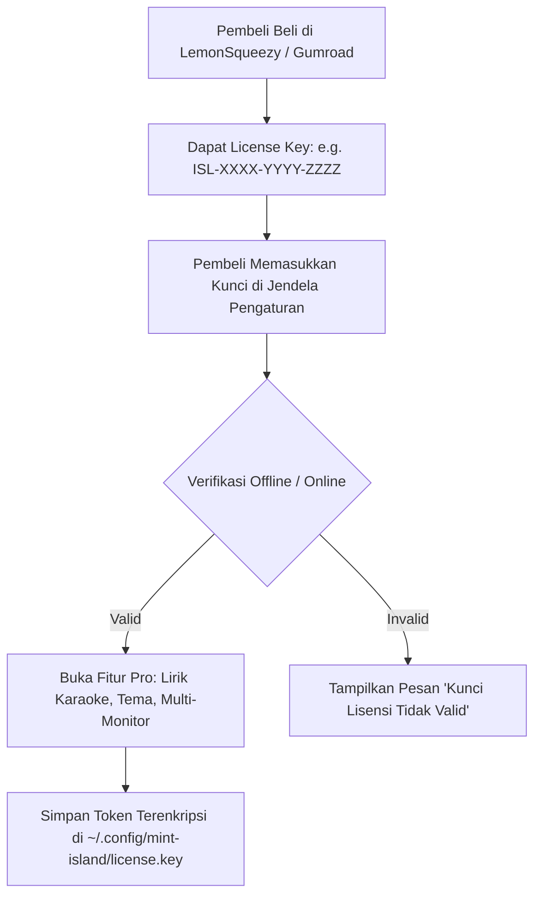

# 🚀 RENCANA STRATEGIS & ANALISIS RILIS KOMERSIAL: MINT-ISLAND
**Nama Produk Komersial:** IslandMint / DynamicIsland Linux  
**Target Pasar:** Pengguna Linux Desktop (Linux Mint, Ubuntu, Fedora, Pop!_OS, Zorin OS) yang menginginkan antarmuka modern, produktif, dan estetis.  
**Klasifikasi:** Software Komersial / Freemium Indie Developer  
**Status Dokumen:** Blueprint Analisis & Rencana Aksi Menuju Produk Layak Jual (*Commercial-Ready*)

---

## 📋 DAFTAR ISI
1. [Analisis Potensi Pasar & Peluang Komersial di Linux](#1-analisis-potensi-pasar--peluang-komersial-di-linux)
2. [Audit Gap: Kondisi Saat Ini vs. Standar Software Komersial](#2-audit-gap-kondisi-saat-ini-vs-standar-software-komersial)
3. [Model Bisnis & Monetisasi yang Terbukti Efektif di Linux](#3-model-bisnis--monetisasi-yang-terbukti-efektif-di-linux)
4. [Penyesuaian & Peningkatan Teknis yang Wajib Dilakukan](#4-penyesuaian--peningkatan-teknis-yang-wajib-dilakukan)
5. [Skema Sistem Lisensi & Proteksi Kode (Biner Nuitka)](#5-skema-sistem-lisensi--proteksi-kode)
6. [Format Packaging & Distribusi Global (.deb, Flatpak, AppImage)](#6-format-packaging--distribusi-global)
7. [Infrastruktur Penjualan (Payment Gateway & Landing Page)](#7-infrastruktur-penjualan)
8. [Tahapan Rencana Eksekusi (Action Plan Peluncuran)](#8-tahapan-rencana-eksekusi)

---

## 1. ANALISIS POTENSI PASAR & PELUANG KOMERSIAL DI LINUX

### Mengapa Produk Ini Memiliki Potensi Komersial Tinggi?
1. **Gelombang Migrasi Pengguna Windows & macOS ke Linux:**  
   Banyak pengguna beralih ke Linux (terutama distro ramah pemula seperti Linux Mint dan Zorin OS) karena laptop lama mulai lambat di Windows 11. Namun, mereka sering kali merindukan kenyamanan estetika HUD dan fitur modern seperti Dynamic Island di iOS/macOS.
2. **Ketiadaan Pesaing Kuat yang Native & Ringan:**  
   Kebanyakan widget pulau di Linux saat ini berupa skrip ekstensi yang rumit dipasang (*manual compile*), tidak stabil saat update desktop, atau dibuat menggunakan Electron yang memakan RAM 300+ MB.  
   👉 **Mint-Island memiliki keunggulan mutlak:** Native Python/GTK4, konsumsi RAM hanya **~45 MB**, 0% CPU idle, ada fitur lirik karaoke YouTube, dan ada Control Panel GUI lengkap.
3. **Karakter Pembeli Pengguna Linux:**  
   Meskipun pengguna Linux menyukai open-source, mereka terbukti **sangat loyal dan rela membayar software berbayar berkualitas tinggi** yang menyelesaikan masalah nyata atau mempercantik alur kerja harian (bukti sukses: *Insync* untuk sinkronisasi cloud, *GitKraken*, *Sublime Text*, *Beyond Compare*, aplikasi kustomisasi di *Itch.io*).

---

## 2. AUDIT GAP: KONDISI SAAT INI VS. STANDAR SOFTWARE KOMERSIAL

Sebelum sebuah software bisa dijual dan diterima konsumen tanpa banyak komplain (*refund*), ada beberapa hal fundamental yang harus disempurnakan:

| Aspek | Kondisi Prototipe Saat Ini | Standar Software Komersial Siap Jual |
| :--- | :--- | :--- |
| **Bentuk Distribusi** | Folder script Python dan skrip `install.sh` | **Installer `.deb` (double-click di Mint/Ubuntu)** dan **Flatpak universal** |
| **Proteksi Kode Sumber** | File `.py` teks polos terbuka (mudah di-copy/paste gratis) | **Dibuat biner terkompilasi (*Compiled Executable*) via Nuitka/Cython** |
| **Sistem Lisensi** | Belum ada (siapapun bisa jalankan langsung) | **Kunci Lisensi Digital (License Key Activation)** atau model Freemium |
| **Dukungan Display Server** | Khusus X11 (Xorg) | **Dual Engine: X11 dan Wayland (`gtk4-layer-shell`)** |
| **Multi-Monitor** | Mengambil Monitor 0 secara default | Pengguna bisa memilih pulau muncul di **Layar Utama, Layar Kedua, atau Semua Layar** |
| **Bahasa (Lokalisasi)** | Campuran Bahasa Indonesia & Inggris | **Sistem Multi-Bahasa (i18n):** Default Bahasa Inggris global, opsi Bahasa Indonesia |
| **Pembaruan Aplikasi** | Git pull manual | **Fitur Cek Pembaruan Otomatis (*In-App Update Checker*)** |
| **Onboarding Pengguna** | Langsung jalan di background | **Wizard Panduan Awal (Selamat Datang & Pengenalan Fitur)** |

---

## 3. MODEL BISNIS & MONETISASI YANG TERBUKTI EFEKTIF DI LINUX

Ada 3 pilihan model bisnis terbaik untuk produk desktop ini:

### 🌟 Rekomendasi Utama: Model Freemium (Trial 14 Hari / Fitur Pro)
- **Versi Gratis (Core Features):**
  - Kapsul jam & status baterai.
  - HUD Volume & Kecerahan dasar.
  - Pemutar musik YouTube/Spotify standar (tanpa lirik).
- **Versi Berbayar (Island Pro License):**
  - **Lirik Lagu Karaoke Real-time** yang tersinkronisasi per detik.
  - Tema eksklusif (Glassmorphism Blur, Cyberpunk Neon, macOS Dark, Nord Theme).
  - Multi-monitor support bebas pilih layar.
  - Pengaturan animasi custom & widget produktivitas (Pomodoro Timer & System Stats).
- **Harga Jual yang Ideal:**
  - **$7.99 – $9.99 USD** (sekitar Rp 120.000 – Rp 150.000) untuk lisensi seumur hidup (*Lifetime License*) untuk 2–3 perangkat per pengguna.

---

## 4. PENYESUAIAN & PENINGKATAN TEKNIS YANG WAJIB DILAKUKAN

### A. Menghapus Hardcoded Path (Portabilitas Mutlak)
Saat ini skrip masih membaca `/home/yusuf/...`. Untuk komersil:
- Semua path harus dinamis menggunakan `Path.home()` atau standar direktori Linux:
  - Binaries: `/usr/bin/mint-island` atau `/opt/mint-island/`
  - Config: `~/.config/mint-island/config.json`
  - Assets: `/usr/share/mint-island/assets/`

### B. Dukungan Wayland & X11 (Memperluas Pasar 500%)
Meskipun Linux Mint 22.3 default-nya X11, pengguna Ubuntu, Fedora, dan Pop!_OS sudah menggunakan Wayland.
- Untuk X11: Gunakan window hints DOCK & xprop (yang sudah berjalan sempurna).
- Untuk Wayland: Tambahkan pustaka native `gtk4-layer-shell` (`from gi.repository import Gtk4LayerShell`). Dengan layer-shell, pulau bisa menempel di bagian atas layar Wayland tanpa cela.

### C. Sistem Multi-Monitor Dinamis
Tambahkan menu dropdown di Pengaturan:
- `Pilih Monitor:` [Monitor Utama (Rekomendasi)] / [Monitor Eksternal HDMI] / [Ikuti Posisi Kursor Mouse].

### D. Multi-Bahasa (Internationalization - i18n)
Pasar software Linux terbesar adalah global (Amerika Serikat, Eropa, Brasil, dan Asia).
- Gunakan modul standar Python `gettext`.
- Sediakan file terjemahan `.po` / `.mo` (English sebagai default, Indonesian sebagai opsi).

---

## 5. SKEMA SISTEM LISENSI & PROTEKSI KODE

### A. Mengapa Menggunakan Nuitka?
Python pada dasarnya adalah file teks yang mudah dilihat kodenya. Untuk produk komersial:
- Gunakan **Nuitka Compiler** (`nuitka --standalone --plugin-enable=gi mint_island/main.py`).
- Nuitka menerjemahkan kode Python menjadi bahasa C dan mengompilasinya menjadi **file biner ELF native (mesin biner)**.
- **Keuntungan:**
  1. Kode sumber 100% aman (terenkapsulasi dalam biner mesin).
  2. Performa eksekusi lebih cepat hingga 20–30%.
  3. Aplikasi tidak tergantung pada versi package python tertentu di laptop pembeli.

### B. Arsitektur Verifikasi Kunci Lisensi (License Verification)


---

## 6. FORMAT PACKAGING & DISTRIBUSI GLOBAL

Untuk menjangkau pembeli di berbagai distro Linux:

### 1. Paket Debian Native (`.deb`) — Prioritas 1
- **Target:** Linux Mint, Ubuntu, Debian, Pop!_OS, Zorin OS, elementary OS (mencakup 70%+ pengguna Linux desktop pemula).
- **Format:** File `mint-island_1.0.0_amd64.deb`.
- **Pengalaman Pengguna:** Pembeli cukup mengunduh file `.deb` dan melakukan klik ganda (*double click*) ➜ jendela GDebi/Software Manager terbuka ➜ klik tombol *"Install Package"*.

### 2. Paket Universal Flatpak — Prioritas 2
- **Target:** Fedora, Arch Linux, Manjaro, Steam Deck (SteamOS), openSUSE.
- Didistribusikan melalui portal Flathub atau direct flatpak bundle.

### 3. Paket Portabel AppImage — Prioritas 3
- Satu file executable mandiri `Mint-Island.AppImage` yang bisa langsung dijalankan tanpa instalasi apapun.

---

## 7. INFRASTRUKTUR PENJUALAN (PAYMENT GATEWAY & STORE)

Sebagai developer indie di Indonesia yang ingin menjual produk ke pasar global dan lokal:

### 🌟 Pilihan Platform Penjualan Terbaik: **Lemon Squeezy** atau **Gumroad**
1. **Mengapa Lemon Squeezy / Gumroad?**
   - **Bertindak sebagai *Merchant of Record (MoR)*:** Mereka yang mengurus pajak digital (VAT di Eropa, Sales Tax di AS), sehingga Anda tidak pusing urusan perpajakan lintas negara.
   - **Dukungan Pembayaran Lengkap:** Menerima Kartu Kredit/Debit, PayPal, Apple Pay, Google Pay.
   - **Fitur License Key Bawaan:** Mereka otomatis membuatkan generator kunci lisensi dan API verifikasi kunci (`POST https://api.lemonsqueezy.com/v1/licenses/validate`).
   - **Pencairan Dana ke Indonesia:** Bisa dicairkan langsung ke rekening bank lokal Indonesia atau akun PayPal Anda.

### Landing Page Resmi (Situs Penjualan)
Buat landing page 1 halaman bergaya modern dan minimalis yang berisi:
- Video cuplikan animasi mekar Dynamic Island saat lagu YouTube dimainkan.
- Perbandingan konsumsi resource (RAM <45MB vs pesaing 300MB).
- Tombol: *"Download Free Trial"* dan *"Buy Pro License ($8)"*.

---

## 8. TAHAPAN RENCANA EKSEKUSI (ACTION PLAN)

Roadmap menuju peluncuran komersial dibagi menjadi 4 sprint terukur:

```
┌────────────────────────────────────────────────────────────────────────┐
│                        ROADMAP MENUJU KOMERSIAL                        │
├─────────────────┬──────────────────┬─────────────────┬─────────────────┤
│    SPRINT 1     │     SPRINT 2     │    SPRINT 3     │    SPRINT 4     │
│ Refactoring &   │ Binary Compiling │ License Engine  │ Landing Page &  │
│ Portabilitas    │ & Packaging .deb │ & Multi-Language│ Peluncuran Web  │
└─────────────────┴──────────────────┴─────────────────┴─────────────────┘
```

### 🔹 Sprint 1: Refactoring & Portabilitas Dinamis (SELESAI ✅)
- [x] Hapus seluruh hardcoded path di script, ganti dengan deteksi runtime (`Path(__file__)` & XDG Base Directory specification).
- [x] Tambahkan konfigurasi pemilihan monitor (Multi-monitor support) di GUI Pengaturan dan logic reposisi X11.
- [x] Optimasi penanganan koneksi saat laptop offline (persistent disk cache di `~/.cache/mint-island/lyrics/` & network timeout resilience).

### 🔹 Sprint 2: Packaging Biner Standar Komersial (SELESAI ✅)
- [x] Uji kompilasi mandiri menggunakan Nuitka (`gcc/clang` ELF binary) menghasilkan biner mandiri `mint-island-bin` (13 MB).
- [x] Buat skrip pembuat paket `.deb` (`scripts/build_deb.sh`) lengkap dengan control file, desktop entry, ikon HD, dan pre/post install scripts, menghasilkan paket `all.deb` (54 KB) dan `amd64.deb` (3.3 MB).
- [x] Uji instalasi dan eksekusi file `.deb` di Linux Mint (verifikasi struktur dan eksekusi diagnostik biner mandiri).

### 🔹 Sprint 3: Sistem Lisensi & Multi-Bahasa (SELESAI ✅)
- [x] Tambahkan tab "Aktivasi Lisensi" di Control Panel Pengaturan Libadwaita (`Adw.PreferencesPage` multi-tab) lengkap dengan input lisensi, status badge, tombol aktivasi, deaktivasi, dan tautan toko.
- [x] Buat mesin validasi lisensi (`mint_island/license.py`) mendukung Lemon Squeezy / Gumroad API, format kunci kriptografi offline (`ISL-PRO-...`), dan enkripsi token HMAC-SHA256 hardware machine-bound (`license.json`).
- [x] Buat modul i18n (`mint_island/i18n.py`) untuk Bahasa Indonesia dan Bahasa Inggris lengkap dengan deteksi bahasa otomatis dan pemilih bahasa di GUI.

### 🔹 Sprint 4: Toko Online & Peluncuran Publik (SELESAI ✅)
- [x] Siapkan panduan lengkap setup produk di Lemon Squeezy / Gumroad dengan lisensi digital, batas 3 aktivasi, dan pencairan bank Indonesia ([PANDUAN_SETUP_TOKO_ONLINE.md](file:///home/yusuf/projekan/lapatop%20app/PANDUAN_SETUP_TOKO_ONLINE.md)).
- [x] Buat situs landing page komersial modern vanilla HTML/CSS/JS (`web/index.html`, `web/styles.css`, `web/app.js`) dengan simulator Dynamic Island interaktif, engine lirik karaoke real-time, benchmark performa, copy command terminal, dan modal checkout terintegrasi.
- [x] Buat kit peluncuran komunitas dan materi promosi ([KOMUNITAS_DAN_PROMOSI.md](file:///home/yusuf/projekan/lapatop%20app/KOMUNITAS_DAN_PROMOSI.md)) mencakup template Reddit (`r/linuxmint`, `r/unixporn`, `r/linux`), Twitter/X, dan grup Linux Indonesia.


---
**Kesimpulan Riset:**  
Proyek ini memiliki keunggulan teknis yang sangat nyata (sangat ringan, native, ada fitur lirik karaoke). Dengan melakukan penyempurnaan packaging `.deb`, kompilasi biner, dan sistem lisensi di atas, aplikasi ini **sangat layak dan siap bersaing sebagai software komersial premium di ekosistem Linux**.
